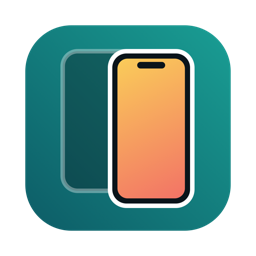

# MirrorAct 繁中整合版

一款 Mac App 同時提供 iPhone／iPad 的 **USB 鏡像、AirPlay 接收**，以及可直接拖曳縮放的**畫中畫視窗**。Android 鏡像、截圖和錄影等原有功能也保留。

本專案以 [sopitz/MirrorAct](https://github.com/sopitz/MirrorAct) 0.2.3 為基礎，合併先前獨立的「鏡像畫中畫」功能；兩者的原始碼都依 GPL-3.0-or-later 授權。感謝原作者 sopitz；本整合版由 pc155139-stack 維護。英文原版說明保留在 [README.en.md](README.en.md)，授權全文見 [LICENSE](LICENSE)。

## 下載與安裝

到本專案的 [Releases](https://github.com/pc155139-stack/MirrorAct-zh-TW/releases) 下載最新 `MirrorAct-zh-TW-…-macOS-arm64.zip`，解壓後將 `MirrorAct.app` 拖進「應用程式」。**使用成品 App 不需要安裝 Xcode、Homebrew 或另外下載「鏡像畫中畫」。**

目前測試包支援 **Apple Silicon、macOS 15 或更新版本**。此版本使用臨時簽章，尚未取得 Apple Developer ID 簽章或 Apple 公證；若 macOS 首次阻擋開啟，請在「系統設定 → 隱私權與安全性」確認並允許開啟。授予相機權限後，USB 鏡像才能讀取 iPhone／iPad 畫面。

## 使用

1. **USB：**連接並解鎖 iPhone／iPad，在手機按「信任這部電腦」，於 MirrorAct 主畫面點選裝置。首次使用請允許 Mac 的相機權限。
2. **AirPlay：**讓手機與 Mac 位於可互通的網路，於手機「控制中心 → 螢幕鏡像輸出」選擇 MirrorAct；若顯示驗證碼，依畫面輸入。
3. **畫中畫：**開啟鏡像視窗後，按右側工具列的「畫中畫」，或選「裝置 → 畫中畫」（⌥⌘P）。拖曳視窗邊緣或四角可維持畫面比例縮放；拖曳畫面可移動視窗。關閉畫中畫視窗會返回原本的鏡像視窗。右鍵可切換聲音、置頂及回到一般視窗。
4. 在「設定 → 一般 → 語言」可選「繁體中文」，按「立即重新啟動」套用。

畫中畫與一般視窗共用同一條鏡像連線，不會重複擷取手機。此 App **不是 Google Cast／Chromecast 接收器**；緯來 App 的「投放至裝置」功能目前不屬於本整合版。

## 從原始碼建置

需要完整 Xcode、XcodeGen、CMake、pkgconf、libplist 和 OpenSSL 3。執行 `scripts/package-test-app.sh` 可建置並產生可複製到另一台 Mac 的 ZIP。首次建置會下載固定版本的 UxPlay 與 scrcpy 元件。建置只需在製作安裝包的 Mac 上進行，其他 Mac 使用 ZIP 中的 App 即可。

原版的開發與功能說明見 [README.en.md](README.en.md)；其中上游的 Homebrew 與發行版連結**不是**本繁中整合版的下載來源。
